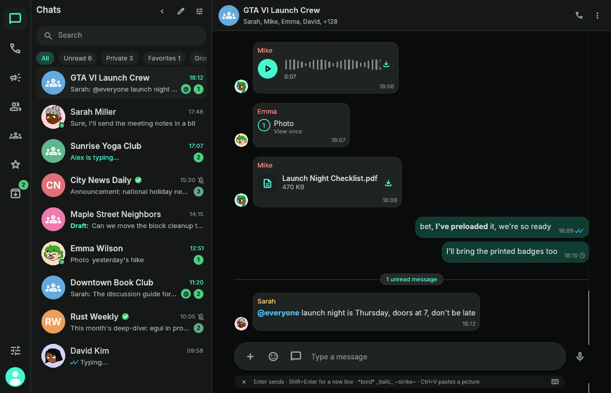

<h1 align="center">Zaprust</h1>

A WhatsApp Client built natively with Rust.

## Features

- Chats, groups, and communities
- Voice notes with playback speed and seek
- Polls, reactions, replies, forwards
- Quick replies
- Themes generated from a single seed color, dark and light
- Desktop notifications

## Install

Download the build for your system from [Releases](https://github.com/fanyzp/zaprust/releases):

| Platform | File |
|---|---|
| Windows (x64 / ARM64) | `zaprust-windows-x86_64.exe`, `zaprust-windows-arm64.exe` |
| Linux (x64 / ARM64) | `zaprust-linux-<arch>.deb`, `.rpm`, or `.AppImage` |
| macOS (Apple Silicon) | `zaprust-macos-arm64` |

Run it, then link your phone with the QR code or a pairing code, the same way as WhatsApp Web.
