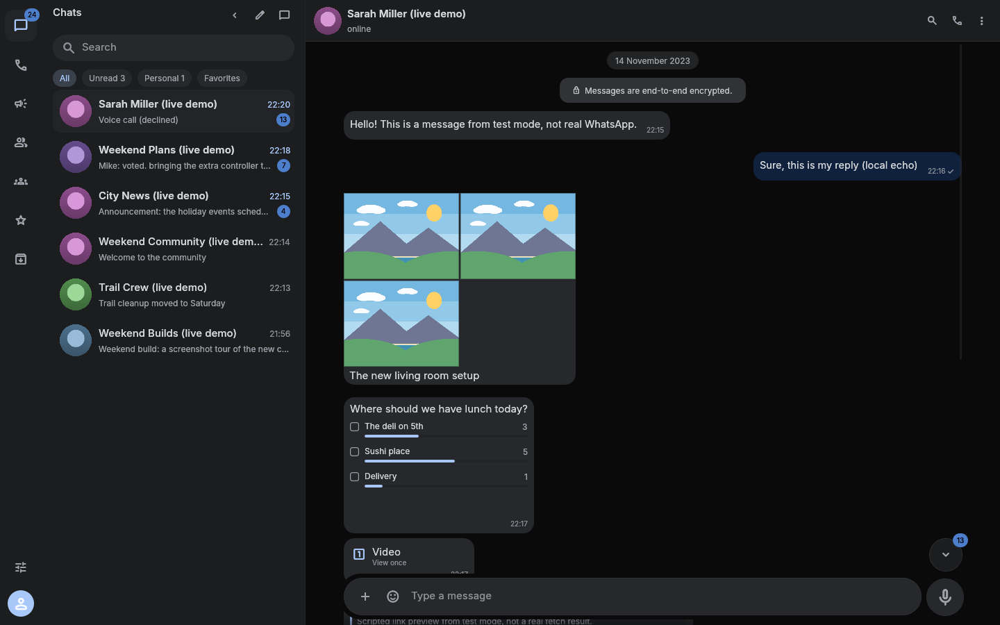
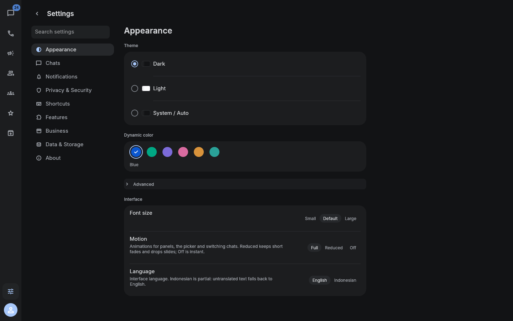

<h1 align="center">Zaprust</h1>

A WhatsApp Client built natively with Rust.

## Features

- Chats, groups, communities, and channels
- Voice notes with playback speed and seek
- Voice and video calls, group calls, call links, and in-call reactions
- Polls, reactions, replies, forwards
- Quick replies
- Themes generated from a single seed color, dark and light
- Desktop notifications
- Chat lock and app lock, a blocked contacts page, system tray residence, and keyboard shortcuts
- Arabic and Hebrew text with proper shaping and reading order

## Install

Download `zaprust-linux-x86_64` from [Releases](https://github.com/fanyzp/zaprust/releases). Each release also carries `SHA256SUMS` and its signature `SHA256SUMS.sig`, so the download can be verified before running it.

Run it, then link your phone with the QR code or a pairing code, the same way as WhatsApp Web.
